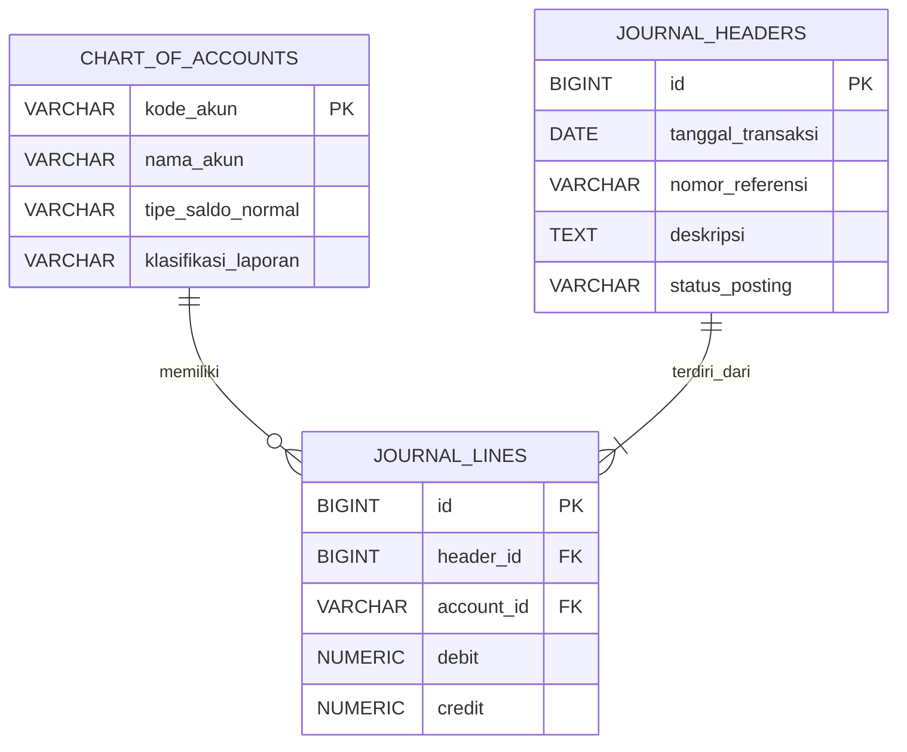

# Pengkodean dan Pemrograman

**Naila Qanitah Syahad** (12030124130094)
Dosen Pengampu: Dr. Totok Dewayanto, S.E., M.Si., Akt.

**Repositori GitHub:** [UTS-Kode-094](https://github.com/nailasyahad-oss/UTS-Kode-094)

---

## Daftar Isi

- **Bagian I**: Perancangan Skema Relasional (ERD), DDL SQL, Analisis Audit, dan Lampiran Kode SQL
- **Bagian II**: Otomatisasi Mutasi Stok (Trigger), Penanganan Concurrency, dan DDL Jurnal
- **Bagian III**: Voucher Kas Keluar dan Analisis Kesesuaian Standar Akuntansi

---

# Bagian I: Perancangan Skema Relasional, Analisis Audit, dan Lampiran SQL

## 1. Perancangan Skema Relasional (ERD)

Kardinalitas relasi ERD:

1. `journal_headers` ke `journal_lines` adalah **1:N**. Satu bukti jurnal punya minimal dua baris, yaitu satu debit dan satu kredit.
2. `chart_of_accounts` ke `journal_lines` adalah **1:N**. Satu akun bisa dipakai di banyak baris jurnal.
3. `journal_lines` menjadi tabel penghubung antara jurnal dan akun.



---

## 2. DDL SQL

### 2.1. Penjelasan Bagian Penting Kode

#### 2.1.1. `PRIMARY KEY`

Setiap tabel memiliki identitas unik. Contohnya, `header_id` membedakan satu jurnal dari jurnal lainnya, sedangkan `line_id` membedakan setiap rincian jurnal.

#### 2.1.2. `FOREIGN KEY` dan `ON DELETE RESTRICT`

Pada tabel `journal_lines`, `header_id` harus mengacu pada jurnal yang sudah ada dan `account_id` harus mengacu pada akun yang sudah terdaftar.

Klausa `ON DELETE RESTRICT` mencegah header atau akun dihapus selama masih direferensikan oleh baris jurnal. Dengan demikian, referensi transaksi historis tetap terjaga.

#### 2.1.3. `CHECK (debit >= 0)` dan `CHECK (credit >= 0)`

Kedua constraint tersebut mencegah nilai nominal negatif. Nilai nol tetap diperbolehkan karena satu baris jurnal biasanya hanya mempunyai nominal debit atau nominal kredit.

#### 2.1.4. `CHECK (debit > 0 OR credit > 0)`

Constraint ini menolak baris jurnal apabila debit dan kredit sama-sama nol. Contoh:

| Debit | Kredit | Hasil |
|---:|---:|---|
| 100.000 | 0 | Diterima |
| 0 | 100.000 | Diterima |
| 100.000 | 100.000 | Diterima oleh constraint ini |
| 0 | 0 | Ditolak |
| -100.000 | 0 | Ditolak |

### 2.2. Bagaimana Memastikan Total Debit Sama dengan Total Kredit?

Setiap baris di atas lolos dari constraint nominal, tetapi jurnalnya tidak seimbang. Karena itu, `CHECK` biasa pada satu baris tidak cukup untuk memastikan bahwa total debit sama dengan total kredit pada seluruh baris dengan `header_id` yang sama.

Solusi yang tepat adalah menambahkan validasi pada proses posting jurnal menggunakan *stored procedure* atau *constraint trigger* yang memeriksa:

$$\sum \text{Debit} = \sum \text{Kredit}$$

Jurnal baru boleh berubah menjadi `POSTED` apabila total debit sama dengan total kredit dan terdapat rincian jurnal yang valid. Implementasi validasi juga harus menangani transaksi bersamaan agar dua proses tidak dapat melewati pemeriksaan secara bersamaan. Bagian ini memperkuat penerapan *double-entry bookkeeping* yang menjadi inti masalah dalam soal.

---

## 3. Analisis Audit dan Keamanan Finansial

### 3.1. Mengapa Model Header-Line Lebih Andal daripada Tabel Tunggal?

Model Header-Line memisahkan informasi umum transaksi dari rincian akun yang terlibat dalam transaksi. Model ini lebih tepat untuk sistem General Ledger karena satu transaksi akuntansi dapat melibatkan dua atau lebih akun.

Perbandingannya sebagai berikut:

| Aspek | Model Header-Line | Model Tabel Tunggal (Flat Table) |
|---|---|---|
| **Struktur data** | Header dan rincian dipisahkan | Informasi transaksi dan rincian akun dicampur |
| **Transaksi dengan banyak akun** | Dapat menyimpan banyak baris melalui satu `header_id` | Informasi header berulang pada setiap baris |
| **Redundansi** | Mengurangi pengulangan tanggal, nomor bukti, dan deskripsi | Berpotensi mengulang informasi transaksi |
| **Konsistensi data** | Informasi umum transaksi disimpan pada satu header | Perubahan informasi header berpotensi menimbulkan inkonsistensi |
| **Audit trail** | Identitas transaksi dapat ditelusuri melalui header dan rincian | Penelusuran transaksi lebih sulit ketika data umum dan detail bercampur |

**Contoh:** transaksi pembayaran perlengkapan sebesar Rp100.000 memerlukan dua baris jurnal: debit Perlengkapan dan kredit Kas. Dalam model Header-Line, kedua baris tersebut terhubung ke satu header sehingga keduanya diketahui sebagai bagian dari transaksi yang sama. Sebaliknya, jika menggunakan satu tabel tunggal, tanggal, nomor bukti, dan deskripsi transaksi harus diulang untuk setiap baris jurnal. Pengulangan tersebut meningkatkan risiko ketidakkonsistenan apabila suatu informasi diperbarui hanya pada sebagian baris.

### 3.2. Hubungan dengan Normalisasi Bentuk Normal Ketiga (3NF)

Normalisasi adalah proses pengorganisasian data untuk mengurangi redundansi dan mencegah anomali ketika data ditambahkan, diperbarui, atau dihapus. Model yang dirancang dapat dijelaskan melalui tiga tahap berikut:

#### 3.2.1. Bentuk Normal Pertama (1NF)

Setiap kolom menyimpan satu nilai, dan setiap baris dapat diidentifikasi secara unik melalui Primary Key. Rincian jurnal disimpan sebagai baris terpisah, bukan sebagai daftar akun dalam satu kolom.

#### 3.2.2. Bentuk Normal Kedua (2NF)

Seluruh atribut non-key harus bergantung pada keseluruhan kunci kandidat, bukan hanya sebagian dari kunci komposit. Dalam rancangan ini, setiap tabel menggunakan Primary Key tunggal sehingga tidak terdapat ketergantungan parsial terhadap Primary Key tersebut.

#### 3.2.3. Bentuk Normal Ketiga (3NF)

Atribut non-key harus bergantung pada kunci, keseluruhan kunci, dan tidak bergantung secara transitif pada kunci melalui atribut non-key lainnya.

Sebagai contoh, `account_name` dan `normal_balance` disimpan di `chart_of_accounts`, bukan diulang pada setiap baris `journal_lines`. Sementara itu, `transaction_date` dan `description` disimpan di `journal_headers`, bukan diulang untuk setiap rincian jurnal.

Pemisahan ini membantu memastikan bahwa setiap atribut disimpan pada tabel yang sesuai dengan ketergantungan datanya.

> **Kesimpulan normalisasi:** rancangan Header-Line mendukung penerapan 3NF karena informasi akun, informasi transaksi, dan rincian jurnal ditempatkan pada entitas yang berbeda. Meskipun demikian, pemenuhan 3NF secara formal tetap bergantung pada seluruh ketergantungan fungsional yang berlaku pada skema tersebut.

### 3.3. Bagaimana Model Ini Mendukung Audit Trail?

Audit trail adalah kemampuan untuk menelusuri transaksi berdasarkan bukti dan rincian pencatatannya. Model Header-Line mendukung audit trail melalui beberapa mekanisme:

1. `reference_no` mengidentifikasi nomor bukti transaksi.
2. `transaction_date` menunjukkan tanggal transaksi.
3. `description` memberikan keterangan mengenai transaksi.
4. `header_id` menghubungkan informasi umum transaksi dengan seluruh baris jurnalnya.
5. `account_id` menunjukkan akun yang digunakan dalam setiap baris.
6. `posting_status` menunjukkan apakah jurnal masih berstatus `DRAFT` atau sudah `POSTED`.

**Ilustrasi:** auditor yang memeriksa pembayaran perlengkapan dapat mencari nomor bukti transaksi, melihat tanggal dan deskripsinya, kemudian menelusuri baris debit Perlengkapan serta kredit Kas melalui `header_id`.

> **Catatan:** struktur Header-Line mendukung penelusuran transaksi, tetapi tidak otomatis menjamin seluruh riwayat perubahan tercatat. Untuk audit trail yang lebih kuat, sistem perlu dilengkapi dengan log perubahan, identitas pengguna, waktu perubahan, dan pengendalian agar jurnal yang telah dibukukan tidak diubah tanpa prosedur yang sah.

---

## 4. Lampiran Kode SQL (PostgreSQL)

Bagian ini memuat kode SQL untuk otomatisasi mutasi stok melalui trigger dan penanganan concurrency pada tabel `inventory_items` dan `inventory_transactions`.

### 4.1. Trigger Function dan Trigger

Fungsi `trg_update_stock_and_journal()` memvalidasi transaksi, mengunci baris barang, menghitung perubahan stok, mencegah stok negatif, lalu memperbarui `stock_qty`. Trigger `AFTER INSERT` menjalankan fungsi ini untuk setiap baris baru di `inventory_transactions`.

> **Catatan:** meskipun bernama `..._and_journal`, fungsi ini hanya memperbarui stok. Pembuatan jurnal otomatis memerlukan logika tambahan dan pemetaan akun ke tabel `journal_headers` dan `journal_lines`.

```sql
-- =========================================
-- 1. TRIGGER FUNCTION
-- =========================================

CREATE OR REPLACE FUNCTION trg_update_stock_and_journal()
RETURNS TRIGGER
LANGUAGE plpgsql
AS $$
DECLARE
    v_stock INT;
    v_change INT;
BEGIN
    -- PURCHASE dan SALE menggunakan qty positif.
    IF NEW.trx_type IN ('PURCHASE', 'SALE')
       AND NEW.qty <= 0 THEN
        RAISE EXCEPTION
            'Quantity untuk PURCHASE/SALE harus positif';
    END IF;

    -- ADJUSTMENT menggunakan qty bertanda:
    -- positif = menambah stok, negatif = mengurangi stok.
    IF NEW.trx_type = 'ADJUSTMENT'
       AND NEW.qty = 0 THEN
        RAISE EXCEPTION
            'Quantity ADJUSTMENT tidak boleh nol';
    END IF;

    -- Mengunci baris barang agar transaksi bersamaan
    -- untuk item yang sama diproses secara bergiliran.
    SELECT stock_qty
    INTO v_stock
    FROM inventory_items
    WHERE item_id = NEW.item_id
    FOR UPDATE;

    IF NOT FOUND THEN
        RAISE EXCEPTION
            'Barang dengan ID % tidak ditemukan',
            NEW.item_id;
    END IF;

    -- Menentukan perubahan stok.
    CASE NEW.trx_type
        WHEN 'PURCHASE' THEN
            v_change := NEW.qty;

        WHEN 'SALE' THEN
            v_change := -NEW.qty;

        WHEN 'ADJUSTMENT' THEN
            v_change := NEW.qty;

        ELSE
            RAISE EXCEPTION
                'Jenis transaksi tidak valid: %',
                NEW.trx_type;
    END CASE;

    -- Mencegah stok menjadi negatif.
    IF v_stock + v_change < 0 THEN
        RAISE EXCEPTION
            'Stok tidak mencukupi. Stok saat ini: %, perubahan: %',
            v_stock, v_change;
    END IF;

    -- Memperbarui stok secara otomatis.
    UPDATE inventory_items
    SET stock_qty = stock_qty + v_change
    WHERE item_id = NEW.item_id;

    RETURN NEW;
END;
$$;


-- =========================================
-- 2. TRIGGER
-- =========================================

CREATE TRIGGER trg_inventory_transaction_insert
AFTER INSERT ON inventory_transactions
FOR EACH ROW
EXECUTE FUNCTION trg_update_stock_and_journal();
```

### 4.2. Concurrency dengan `SELECT ... FOR UPDATE`

Baris barang dikunci di awal transaksi sehingga kasir lain yang memproses item yang sama harus menunggu sampai `COMMIT`. Penguncian dan `INSERT` penjualan harus berada dalam transaksi yang sama.

```sql
BEGIN;

-- Mengunci baris barang yang akan dijual.
SELECT stock_qty
FROM inventory_items
WHERE item_id = 'BRG001'
FOR UPDATE;

-- Aplikasi memeriksa stok yang tersedia.
-- Jika stok mencukupi, masukkan transaksi penjualan.
INSERT INTO inventory_transactions
    (item_id, trx_type, qty)
VALUES
    ('BRG001', 'SALE', 1);

-- Trigger akan memvalidasi stok dan memperbaruinya.
COMMIT;
```

### 4.3. Concurrency dengan Isolasi `SERIALIZABLE`

Transaksi dijalankan pada tingkat isolasi `SERIALIZABLE`. Jika terjadi konflik, salah satu transaksi dapat gagal dengan *serialization error* dan harus diulang oleh aplikasi.

```sql
BEGIN TRANSACTION ISOLATION LEVEL SERIALIZABLE;

INSERT INTO inventory_transactions
    (item_id, trx_type, qty)
VALUES
    ('BRG001', 'SALE', 1);

COMMIT;
```

### 4.4. Ringkasan Validasi pada Trigger

| Validasi | Perilaku |
|---|---|
| `PURCHASE` / `SALE` dengan `qty <= 0` | Ditolak (`RAISE EXCEPTION`). |
| `ADJUSTMENT` dengan `qty = 0` | Ditolak. Nilai positif menambah stok, negatif mengurangi stok. |
| `item_id` tidak ditemukan | Ditolak. |
| `trx_type` selain `PURCHASE`, `SALE`, `ADJUSTMENT` | Ditolak. |
| Stok setelah perubahan kurang dari 0 | Ditolak (mencegah overselling). |

---

# Bagian II: Otomatisasi Mutasi Stok, Concurrency, dan DDL Jurnal

## 1. Otomatisasi Mutasi melalui Database Trigger

### 1.1. Memahami Masalahnya

Soal memberikan dua tabel:

- **`inventory_items`**: menyimpan data barang, jumlah stok, dan biaya per unit.
- **`inventory_transactions`**: menyimpan transaksi `PURCHASE`, `SALE`, atau `ADJUSTMENT`.

Targetnya adalah setiap kali transaksi baru dimasukkan ke `inventory_transactions`, database otomatis memperbarui `stock_qty` pada `inventory_items`.

Contoh sederhana:

| Jenis transaksi | Stok awal | Kuantitas | Stok akhir |
|---|---:|---:|---:|
| `PURCHASE` | 10 | 5 | 15 |
| `SALE` | 10 | 3 | 7 |
| `SALE` melebihi stok | 2 | 5 | Ditolak |

Dengan trigger, aplikasi tidak perlu mengubah stok secara terpisah setelah memasukkan transaksi. Database yang menjalankan logika tersebut secara otomatis.

### 1.2. Penjelasan Kode

| Bagian Kode | Fungsi |
|---|---|
| `CREATE OR REPLACE FUNCTION` | Membuat atau mengganti fungsi trigger. |
| `RETURNS TRIGGER` | Menandakan fungsi digunakan oleh trigger. |
| `NEW` | Mengakses data transaksi yang baru dimasukkan. |
| `SELECT ... FOR UPDATE` | Mengunci baris barang selama transaksi berlangsung. |
| `CASE` | Menentukan perubahan stok berdasarkan jenis transaksi. |
| `RAISE EXCEPTION` | Menolak transaksi apabila kuantitas tidak valid, barang tidak ditemukan, atau stok menjadi negatif. |
| `UPDATE inventory_items` | Memperbarui stok di database. |
| `AFTER INSERT` | Menjalankan fungsi setelah baris transaksi dimasukkan. |

> **Catatan penting mengenai nama fungsi:** soal meminta fungsi bernama `trg_update_stock_and_journal()`, tetapi struktur tabel yang diberikan belum mempunyai tabel jurnal akuntansi maupun informasi akun debit-kredit. Karena itu, kode di atas benar-benar memperbarui stok, tetapi belum menghasilkan jurnal akuntansi. Untuk membuat jurnal otomatis, diperlukan tambahan struktur jurnal dan pemetaan akun. Jangan mengklaim bahwa jurnal sudah tercatat jika tabel dan logika pencatatannya belum dibuat.

Kuantitas `ADJUSTMENT` pada implementasi ini menggunakan tanda **positif** untuk penambahan dan **negatif** untuk pengurangan stok. Konvensi ini perlu dijelaskan karena naskah ujian tidak menetapkan bagaimana kuantitas penyesuaian harus direpresentasikan.

---

## 2. Penanganan Concurrency

### 2.1. Apa Masalahnya?

Misalnya stok barang hanya tersisa 1 unit, lalu dua kasir memproses penjualan masing-masing 1 unit hampir bersamaan. Tanpa penguncian yang benar, kedua kasir berpotensi membaca stok awal yang sama, sehingga total penjualan menjadi 2 unit meskipun stok hanya 1 unit. Kondisi ini disebut **overselling**.

### 2.2. Solusi Menggunakan `SELECT ... FOR UPDATE`

`SELECT ... FOR UPDATE` mengunci baris barang yang sedang diproses. Transaksi lain yang ingin mengunci baris yang sama harus menunggu sampai transaksi pertama selesai.

Jika stok awal hanya 1 unit:

1. Kasir A mendapatkan kunci baris dan memproses penjualan.
2. Kasir B menunggu karena baris barang sedang dikunci.
3. Setelah Kasir A melakukan `COMMIT`, Kasir B membaca stok terbaru ketika memperoleh kunci.
4. Jika stok sudah 0, trigger menjalankan `RAISE EXCEPTION` dan transaksi Kasir B dibatalkan.

Kode contoh ini mengasumsikan aplikasi memeriksa hasil pembacaan stok sebelum melakukan `INSERT`. Trigger tetap menjadi pengendali utama yang mencegah stok negatif, sehingga validasi tidak hanya bergantung pada aplikasi.

> **Penting:** penguncian harus berlangsung dalam transaksi yang sama dengan proses penjualan. Jika penguncian dilepas sebelum penjualan diproses, perlindungannya tidak memadai.

### 2.3. Alternatif Menggunakan Isolasi `SERIALIZABLE`

Alternatif lainnya adalah menjalankan transaksi pada tingkat isolasi `SERIALIZABLE`. Pada tingkat isolasi ini, PostgreSQL memastikan transaksi yang berhasil dapat diperlakukan seolah-olah berjalan dalam urutan serial. Jika terjadi konflik, salah satu transaksi dapat gagal dengan *serialization error* dan harus diulang oleh aplikasi.

Walaupun demikian, `SERIALIZABLE` bukan pengganti penanganan error. Aplikasi harus siap mengulang transaksi yang gagal. Dalam kasus persediaan sederhana, `SELECT ... FOR UPDATE` pada baris barang yang tepat merupakan pendekatan langsung untuk mengendalikan akses bersamaan.

### 2.4. Perbandingan Kedua Metode

| Aspek | `SELECT ... FOR UPDATE` | `SERIALIZABLE` |
|---|---|---|
| **Cara kerja** | Mengunci baris tertentu | Mengendalikan konflik berdasarkan isolasi serial |
| **Keunggulan** | Efisien untuk mengamankan stok barang tertentu | Memberikan jaminan isolasi transaksi yang lebih ketat |
| **Konsekuensi** | Transaksi lain yang membutuhkan baris terkunci harus menunggu | Transaksi dapat gagal dan perlu diulang |
| **Penerapan** | Cocok untuk transaksi stok dengan item tertentu | Cocok ketika aturan transaksi lebih kompleks |

---

## 3. DDL SQL (PostgreSQL)

Bagian ini melengkapi catatan pada bagian 1.2: struktur tabel persediaan belum memiliki tabel jurnal akuntansi maupun informasi akun debit-kredit. DDL berikut menyediakan struktur tersebut, yaitu `chart_of_accounts`, `journal_headers`, dan `journal_lines`.

> **Catatan:** DDL ini baru membuat struktur tabel. Validasi total debit sama dengan total kredit (`Σ Debit = Σ Kredit`) belum ada di dalamnya dan perlu ditambahkan melalui *stored procedure* atau *constraint trigger* pada proses posting jurnal.

```sql
-- =========================================
-- 1. TABEL CHART OF ACCOUNTS
-- =========================================

CREATE TABLE chart_of_accounts (
    account_id BIGINT GENERATED ALWAYS AS IDENTITY
        PRIMARY KEY,

    account_code VARCHAR(20) NOT NULL UNIQUE,

    account_name VARCHAR(100) NOT NULL,

    normal_balance VARCHAR(6) NOT NULL
        CHECK (normal_balance IN ('DEBIT', 'CREDIT')),

    report_classification VARCHAR(20) NOT NULL
        CHECK (
            report_classification IN (
                'ASET',
                'LIABILITAS',
                'EKUITAS',
                'PENDAPATAN',
                'BEBAN'
            )
        )
);


-- =========================================
-- 2. TABEL JOURNAL HEADERS
-- =========================================

CREATE TABLE journal_headers (
    header_id BIGINT GENERATED ALWAYS AS IDENTITY
        PRIMARY KEY,

    transaction_date DATE NOT NULL,

    reference_no VARCHAR(50) NOT NULL UNIQUE,

    description TEXT NOT NULL,

    posting_status VARCHAR(10) NOT NULL
        DEFAULT 'DRAFT'
        CHECK (posting_status IN ('DRAFT', 'POSTED'))
);


-- =========================================
-- 3. TABEL JOURNAL LINES
-- =========================================

CREATE TABLE journal_lines (
    line_id BIGINT GENERATED ALWAYS AS IDENTITY
        PRIMARY KEY,

    header_id BIGINT NOT NULL,

    account_id BIGINT NOT NULL,

    debit NUMERIC(15, 2) NOT NULL DEFAULT 0
        CHECK (debit >= 0),

    credit NUMERIC(15, 2) NOT NULL DEFAULT 0
        CHECK (credit >= 0),

    -- Mencegah debit dan kredit sama-sama nol
    CONSTRAINT chk_journal_amount
        CHECK (debit > 0 OR credit > 0),

    -- Relasi ke tabel journal_headers
    CONSTRAINT fk_journal_header
        FOREIGN KEY (header_id)
        REFERENCES journal_headers(header_id)
        ON DELETE RESTRICT,

    -- Relasi ke tabel chart_of_accounts
    CONSTRAINT fk_journal_account
        FOREIGN KEY (account_id)
        REFERENCES chart_of_accounts(account_id)
        ON DELETE RESTRICT
);
```

### 3.1. Ringkasan Tabel

| Tabel | Primary Key | Kolom Penting |
|---|---|---|
| `chart_of_accounts` | `account_id` | `account_code` (unik), `account_name`, `normal_balance` (`DEBIT`/`CREDIT`), `report_classification` (`ASET`, `LIABILITAS`, `EKUITAS`, `PENDAPATAN`, `BEBAN`) |
| `journal_headers` | `header_id` | `transaction_date`, `reference_no` (unik), `description`, `posting_status` (`DRAFT`/`POSTED`, default `DRAFT`) |
| `journal_lines` | `line_id` | `header_id` (FK), `account_id` (FK), `debit`, `credit` |

### 3.2. Constraint pada `journal_lines`

| Constraint | Fungsi |
|---|---|
| `CHECK (debit >= 0)` dan `CHECK (credit >= 0)` | Mencegah nilai nominal negatif. |
| `chk_journal_amount` | Menolak baris jika debit dan kredit sama-sama nol. |
| `fk_journal_header` | `header_id` harus mengacu pada jurnal yang sudah ada. |
| `fk_journal_account` | `account_id` harus mengacu pada akun yang sudah terdaftar. |
| `ON DELETE RESTRICT` | Header atau akun tidak dapat dihapus selama masih direferensikan oleh baris jurnal. |

---

# Bagian III: Voucher Kas Keluar dan Analisis Kesesuaian Standar Akuntansi

## A. Form Entri Jurnal Dinamis

Form web satu halaman (`Voucher Kas Keluar.html`) untuk mencatat voucher kas keluar dengan baris jurnal yang dinamis dan pengecekan keseimbangan debit-kredit secara langsung (*live balancing check*).

### Fitur

- **Metadata voucher**: nomor voucher, tanggal, dan keterangan / dibayar kepada.
- **Baris jurnal dinamis**: baris dapat ditambah atau dihapus (minimal tersisa 1 baris).
- **Pilihan akun**: daftar akun contoh dalam dropdown.
- **Total otomatis**: total debit, total kredit, dan selisih dihitung setiap kali nilai berubah.
- **Indikator keseimbangan**: lencana berubah dari *Tidak Seimbang* (merah) menjadi *Seimbang (Balanced)* (hijau).
- **Tombol simpan terkunci**: tombol *Simpan Voucher* hanya aktif ketika total debit sama dengan total kredit.
- **Modal pesan kustom**: pengganti `alert()` untuk notifikasi sukses dan peringatan.

### Daftar Akun Contoh

| Kode | Nama Akun |
|---|---|
| 1-1110 | Kas Besar / Kecil |
| 1-1120 | Bank BCA |
| 5-1110 | Biaya Gaji |
| 5-1210 | Biaya ATK & Perlengkapan Kantor |
| 5-1310 | Biaya Listrik & Air |
| 5-1410 | Biaya Konsumsi Rapat |
| 2-1110 | Hutang Usaha |

Saat halaman dibuka, form terisi contoh transaksi: **Debit** 5-1210 Biaya ATK & Perlengkapan Kantor Rp150.000 dan **Kredit** 1-1110 Kas Besar / Kecil Rp150.000.

### Cara Menjalankan

1. Simpan file `Voucher Kas Keluar.html`.
2. Buka file tersebut di browser (klik dua kali).
3. Perlu koneksi internet karena Tailwind CSS dan font Inter dimuat dari CDN.

### Fungsi JavaScript Utama

| Fungsi | Kegunaan |
|---|---|
| `formatIDR(amount)` | Memformat angka menjadi mata uang Rupiah. |
| `addRow(defaultAccount, defaultDebit, defaultKredit)` | Menambah baris jurnal baru ke tabel. |
| `removeRow(btn)` | Menghapus baris dan menghitung ulang total. |
| `handleAmountInput(input, type)` | Memicu perhitungan ulang saat nominal diubah. |
| `calculateTotals()` | Menghitung total debit, total kredit, selisih, dan memperbarui status keseimbangan serta tombol simpan. |
| `handleSubmit(event)` | Menangani pengiriman form dan menampilkan pesan sukses. |
| `showModal(...)` / `closeModal()` | Menampilkan dan menutup kotak pesan kustom. |

---

## B. Analisis Kesesuaian Standar Akuntansi dan Pengendalian Internal

### 1. Kesesuaian Komponen Kas dan Setara Kas

**Status: Sesuai**

Standar akuntansi mendefinisikan kas sebagai saldo kas tunai (*cash on hand*) dan rekening giro (*demand deposits*), sedangkan setara kas adalah investasi jangka pendek yang sangat likuid (berjangka waktu 3 bulan atau kurang sejak perolehan) dan bebas dari risiko perubahan nilai yang signifikan. Pemilihan akun Kas Besar/Kecil maupun Rekening Bank pada form voucher kas keluar memenuhi kriteria komponen kas dan setara kas yang digunakan untuk memenuhi komitmen operasional jangka pendek.

### 2. Pengakuan Arus Kas Keluar Aktivitas Operasi

**Status: Sesuai**

Sesuai ketentuan PSAK 2 / PSAK 207, pengeluaran kas untuk pembayaran kepada pemasok, gaji karyawan, serta beban operasional harian diklasifikasikan sebagai pengeluaran kas dari aktivitas operasi. Transaksi melalui voucher kas keluar mencerminkan penurunan manfaat ekonomik masa depan berupa deplesi kas/setara kas yang diakui sebagai beban atau pelunasan liabilitas.

### 3. Validasi Keseimbangan Pencatatan (Double-Entry System)

**Status: Sesuai**

Pengecekan keseimbangan nominal transaksi (`totalDebit === totalKredit`) sebelum form diposting mendukung keandalan pencatatan akuntansi dan keterandalan penyusunan laporan keuangan.

### 4. Catatan dan Rekomendasi Pengendalian Internal (Asersi Audit)

1. **Validasi posisi normal kas keluar:** secara logika akuntansi, transaksi pengeluaran kas wajib menempatkan akun Kas/Bank di posisi **Kredit** (berkurang) dan akun Beban/Utang/Aset di posisi **Debit**. Sistem perlu memvalidasi posisi akun, bukan hanya keseimbangan matematika nominal.
2. **Penanganan kas yang dibatasi (*restricted cash*):** standar akuntansi mengatur bahwa saldo kas atau bank yang penggunaannya dibatasi oleh aturan hukum atau kontrak tidak boleh disajikan atau dikelola sebagai kas bebas tanpa pengungkapan khusus.
3. **Verifikasi bukti pendukung (asersi audit):** untuk memenuhi asersi eksistensi dan kelengkapan, pengeluaran kas melalui voucher harus diverifikasi dengan dokumen pendukung yang sah (seperti kuitansi, nota, atau bukti transfer) serta otorisasi pihak berwenang.

### Ringkasan

| No. | Aspek | Status |
|---|---|---|
| 1 | Kesesuaian komponen kas dan setara kas | Sesuai |
| 2 | Pengakuan arus kas keluar aktivitas operasi | Sesuai |
| 3 | Validasi keseimbangan pencatatan (double-entry) | Sesuai |
| 4 | Pengendalian internal (posisi normal, restricted cash, bukti pendukung) | Catatan dan rekomendasi |
