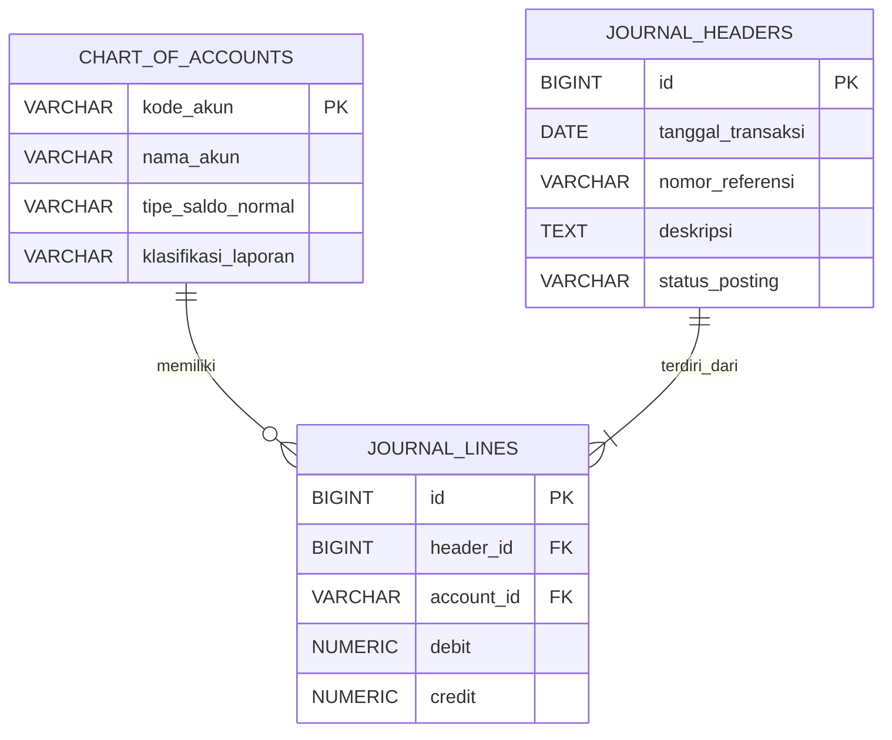

# Pengkodean dan Pemrograman

**Naila Qanitah Syahad** (12030124130094)
Dosen Pengampu: Dr. Totok Dewayanto, S.E., M.Si., Akt.

---

## 1. Perancangan Skema Relasional (ERD)

Kardinalitas relasi ERD:

1. `journal_headers` ke `journal_lines` adalah **1:N**. Satu bukti jurnal punya minimal dua baris, yaitu satu debit dan satu kredit.
2. `chart_of_accounts` ke `journal_lines` adalah **1:N**. Satu akun bisa dipakai di banyak baris jurnal.
3. `journal_lines` menjadi tabel penghubung antara jurnal dan akun.



---

## 2. DDL SQL

### 2.1. Penjelasan Bagian Penting Kode

#### 2.1.1. `PRIMARY KEY`

Setiap tabel memiliki identitas unik. Contohnya, `header_id` membedakan satu jurnal dari jurnal lainnya, sedangkan `line_id` membedakan setiap rincian jurnal.

#### 2.1.2. `FOREIGN KEY` dan `ON DELETE RESTRICT`

Pada tabel `journal_lines`, `header_id` harus mengacu pada jurnal yang sudah ada dan `account_id` harus mengacu pada akun yang sudah terdaftar.

Klausa `ON DELETE RESTRICT` mencegah header atau akun dihapus selama masih direferensikan oleh baris jurnal. Dengan demikian, referensi transaksi historis tetap terjaga.

#### 2.1.3. `CHECK (debit >= 0)` dan `CHECK (credit >= 0)`

Kedua constraint tersebut mencegah nilai nominal negatif. Nilai nol tetap diperbolehkan karena satu baris jurnal biasanya hanya mempunyai nominal debit atau nominal kredit.

#### 2.1.4. `CHECK (debit > 0 OR credit > 0)`

Constraint ini menolak baris jurnal apabila debit dan kredit sama-sama nol. Contoh:

| Debit | Kredit | Hasil |
|---:|---:|---|
| 100.000 | 0 | Diterima |
| 0 | 100.000 | Diterima |
| 100.000 | 100.000 | Diterima oleh constraint ini |
| 0 | 0 | Ditolak |
| -100.000 | 0 | Ditolak |

### 2.2. Bagaimana Memastikan Total Debit Sama dengan Total Kredit?

Setiap baris di atas lolos dari constraint nominal, tetapi jurnalnya tidak seimbang. Karena itu, `CHECK` biasa pada satu baris tidak cukup untuk memastikan bahwa total debit sama dengan total kredit pada seluruh baris dengan `header_id` yang sama.

Solusi yang tepat adalah menambahkan validasi pada proses posting jurnal menggunakan *stored procedure* atau *constraint trigger* yang memeriksa:

$$\sum \text{Debit} = \sum \text{Kredit}$$

Jurnal baru boleh berubah menjadi `POSTED` apabila total debit sama dengan total kredit dan terdapat rincian jurnal yang valid. Implementasi validasi juga harus menangani transaksi bersamaan agar dua proses tidak dapat melewati pemeriksaan secara bersamaan. Bagian ini memperkuat penerapan *double-entry bookkeeping* yang menjadi inti masalah dalam soal.

---

## 3. Analisis Audit dan Keamanan Finansial

### 3.1. Mengapa Model Header-Line Lebih Andal daripada Tabel Tunggal?

Model Header-Line memisahkan informasi umum transaksi dari rincian akun yang terlibat dalam transaksi. Model ini lebih tepat untuk sistem General Ledger karena satu transaksi akuntansi dapat melibatkan dua atau lebih akun.

Perbandingannya sebagai berikut:

| Aspek | Model Header-Line | Model Tabel Tunggal (Flat Table) |
|---|---|---|
| **Struktur data** | Header dan rincian dipisahkan | Informasi transaksi dan rincian akun dicampur |
| **Transaksi dengan banyak akun** | Dapat menyimpan banyak baris melalui satu `header_id` | Informasi header berulang pada setiap baris |
| **Redundansi** | Mengurangi pengulangan tanggal, nomor bukti, dan deskripsi | Berpotensi mengulang informasi transaksi |
| **Konsistensi data** | Informasi umum transaksi disimpan pada satu header | Perubahan informasi header berpotensi menimbulkan inkonsistensi |
| **Audit trail** | Identitas transaksi dapat ditelusuri melalui header dan rincian | Penelusuran transaksi lebih sulit ketika data umum dan detail bercampur |

**Contoh:** transaksi pembayaran perlengkapan sebesar Rp100.000 memerlukan dua baris jurnal: debit Perlengkapan dan kredit Kas. Dalam model Header-Line, kedua baris tersebut terhubung ke satu header sehingga keduanya diketahui sebagai bagian dari transaksi yang sama. Sebaliknya, jika menggunakan satu tabel tunggal, tanggal, nomor bukti, dan deskripsi transaksi harus diulang untuk setiap baris jurnal. Pengulangan tersebut meningkatkan risiko ketidakkonsistenan apabila suatu informasi diperbarui hanya pada sebagian baris.

### 3.2. Hubungan dengan Normalisasi Bentuk Normal Ketiga (3NF)

Normalisasi adalah proses pengorganisasian data untuk mengurangi redundansi dan mencegah anomali ketika data ditambahkan, diperbarui, atau dihapus. Model yang dirancang dapat dijelaskan melalui tiga tahap berikut:

#### 3.2.1. Bentuk Normal Pertama (1NF)

Setiap kolom menyimpan satu nilai, dan setiap baris dapat diidentifikasi secara unik melalui Primary Key. Rincian jurnal disimpan sebagai baris terpisah, bukan sebagai daftar akun dalam satu kolom.

#### 3.2.2. Bentuk Normal Kedua (2NF)

Seluruh atribut non-key harus bergantung pada keseluruhan kunci kandidat, bukan hanya sebagian dari kunci komposit. Dalam rancangan ini, setiap tabel menggunakan Primary Key tunggal sehingga tidak terdapat ketergantungan parsial terhadap Primary Key tersebut.

#### 3.2.3. Bentuk Normal Ketiga (3NF)

Atribut non-key harus bergantung pada kunci, keseluruhan kunci, dan tidak bergantung secara transitif pada kunci melalui atribut non-key lainnya.

Sebagai contoh, `account_name` dan `normal_balance` disimpan di `chart_of_accounts`, bukan diulang pada setiap baris `journal_lines`. Sementara itu, `transaction_date` dan `description` disimpan di `journal_headers`, bukan diulang untuk setiap rincian jurnal.

Pemisahan ini membantu memastikan bahwa setiap atribut disimpan pada tabel yang sesuai dengan ketergantungan datanya.

> **Kesimpulan normalisasi:** rancangan Header-Line mendukung penerapan 3NF karena informasi akun, informasi transaksi, dan rincian jurnal ditempatkan pada entitas yang berbeda. Meskipun demikian, pemenuhan 3NF secara formal tetap bergantung pada seluruh ketergantungan fungsional yang berlaku pada skema tersebut.

### 3.3. Bagaimana Model Ini Mendukung Audit Trail?

Audit trail adalah kemampuan untuk menelusuri transaksi berdasarkan bukti dan rincian pencatatannya. Model Header-Line mendukung audit trail melalui beberapa mekanisme:

1. `reference_no` mengidentifikasi nomor bukti transaksi.
2. `transaction_date` menunjukkan tanggal transaksi.
3. `description` memberikan keterangan mengenai transaksi.
4. `header_id` menghubungkan informasi umum transaksi dengan seluruh baris jurnalnya.
5. `account_id` menunjukkan akun yang digunakan dalam setiap baris.
6. `posting_status` menunjukkan apakah jurnal masih berstatus `DRAFT` atau sudah `POSTED`.

**Ilustrasi:** auditor yang memeriksa pembayaran perlengkapan dapat mencari nomor bukti transaksi, melihat tanggal dan deskripsinya, kemudian menelusuri baris debit Perlengkapan serta kredit Kas melalui `header_id`.

> **Catatan:** struktur Header-Line mendukung penelusuran transaksi, tetapi tidak otomatis menjamin seluruh riwayat perubahan tercatat. Untuk audit trail yang lebih kuat, sistem perlu dilengkapi dengan log perubahan, identitas pengguna, waktu perubahan, dan pengendalian agar jurnal yang telah dibukukan tidak diubah tanpa prosedur yang sah.

---

## 4. Lampiran Kode SQL (PostgreSQL)

Bagian ini memuat kode SQL untuk otomatisasi mutasi stok melalui trigger dan penanganan concurrency pada tabel `inventory_items` dan `inventory_transactions`.

### 4.1. Trigger Function dan Trigger

Fungsi `trg_update_stock_and_journal()` memvalidasi transaksi, mengunci baris barang, menghitung perubahan stok, mencegah stok negatif, lalu memperbarui `stock_qty`. Trigger `AFTER INSERT` menjalankan fungsi ini untuk setiap baris baru di `inventory_transactions`.

> **Catatan:** meskipun bernama `..._and_journal`, fungsi ini hanya memperbarui stok. Pembuatan jurnal otomatis memerlukan logika tambahan dan pemetaan akun ke tabel `journal_headers` dan `journal_lines`.

```sql
-- =========================================
-- 1. TRIGGER FUNCTION
-- =========================================

CREATE OR REPLACE FUNCTION trg_update_stock_and_journal()
RETURNS TRIGGER
LANGUAGE plpgsql
AS $$
DECLARE
    v_stock INT;
    v_change INT;
BEGIN
    -- PURCHASE dan SALE menggunakan qty positif.
    IF NEW.trx_type IN ('PURCHASE', 'SALE')
       AND NEW.qty <= 0 THEN
        RAISE EXCEPTION
            'Quantity untuk PURCHASE/SALE harus positif';
    END IF;

    -- ADJUSTMENT menggunakan qty bertanda:
    -- positif = menambah stok, negatif = mengurangi stok.
    IF NEW.trx_type = 'ADJUSTMENT'
       AND NEW.qty = 0 THEN
        RAISE EXCEPTION
            'Quantity ADJUSTMENT tidak boleh nol';
    END IF;

    -- Mengunci baris barang agar transaksi bersamaan
    -- untuk item yang sama diproses secara bergiliran.
    SELECT stock_qty
    INTO v_stock
    FROM inventory_items
    WHERE item_id = NEW.item_id
    FOR UPDATE;

    IF NOT FOUND THEN
        RAISE EXCEPTION
            'Barang dengan ID % tidak ditemukan',
            NEW.item_id;
    END IF;

    -- Menentukan perubahan stok.
    CASE NEW.trx_type
        WHEN 'PURCHASE' THEN
            v_change := NEW.qty;

        WHEN 'SALE' THEN
            v_change := -NEW.qty;

        WHEN 'ADJUSTMENT' THEN
            v_change := NEW.qty;

        ELSE
            RAISE EXCEPTION
                'Jenis transaksi tidak valid: %',
                NEW.trx_type;
    END CASE;

    -- Mencegah stok menjadi negatif.
    IF v_stock + v_change < 0 THEN
        RAISE EXCEPTION
            'Stok tidak mencukupi. Stok saat ini: %, perubahan: %',
            v_stock, v_change;
    END IF;

    -- Memperbarui stok secara otomatis.
    UPDATE inventory_items
    SET stock_qty = stock_qty + v_change
    WHERE item_id = NEW.item_id;

    RETURN NEW;
END;
$$;


-- =========================================
-- 2. TRIGGER
-- =========================================

CREATE TRIGGER trg_inventory_transaction_insert
AFTER INSERT ON inventory_transactions
FOR EACH ROW
EXECUTE FUNCTION trg_update_stock_and_journal();
```

### 4.2. Concurrency dengan `SELECT ... FOR UPDATE`

Baris barang dikunci di awal transaksi sehingga kasir lain yang memproses item yang sama harus menunggu sampai `COMMIT`. Penguncian dan `INSERT` penjualan harus berada dalam transaksi yang sama.

```sql
BEGIN;

-- Mengunci baris barang yang akan dijual.
SELECT stock_qty
FROM inventory_items
WHERE item_id = 'BRG001'
FOR UPDATE;

-- Aplikasi memeriksa stok yang tersedia.
-- Jika stok mencukupi, masukkan transaksi penjualan.
INSERT INTO inventory_transactions
    (item_id, trx_type, qty)
VALUES
    ('BRG001', 'SALE', 1);

-- Trigger akan memvalidasi stok dan memperbaruinya.
COMMIT;
```

### 4.3. Concurrency dengan Isolasi `SERIALIZABLE`

Transaksi dijalankan pada tingkat isolasi `SERIALIZABLE`. Jika terjadi konflik, salah satu transaksi dapat gagal dengan *serialization error* dan harus diulang oleh aplikasi.

```sql
BEGIN TRANSACTION ISOLATION LEVEL SERIALIZABLE;

INSERT INTO inventory_transactions
    (item_id, trx_type, qty)
VALUES
    ('BRG001', 'SALE', 1);

COMMIT;
```

### 4.4. Ringkasan Validasi pada Trigger

| Validasi | Perilaku |
|---|---|
| `PURCHASE` / `SALE` dengan `qty <= 0` | Ditolak (`RAISE EXCEPTION`). |
| `ADJUSTMENT` dengan `qty = 0` | Ditolak. Nilai positif menambah stok, negatif mengurangi stok. |
| `item_id` tidak ditemukan | Ditolak. |
| `trx_type` selain `PURCHASE`, `SALE`, `ADJUSTMENT` | Ditolak. |
| Stok setelah perubahan kurang dari 0 | Ditolak (mencegah overselling). |
